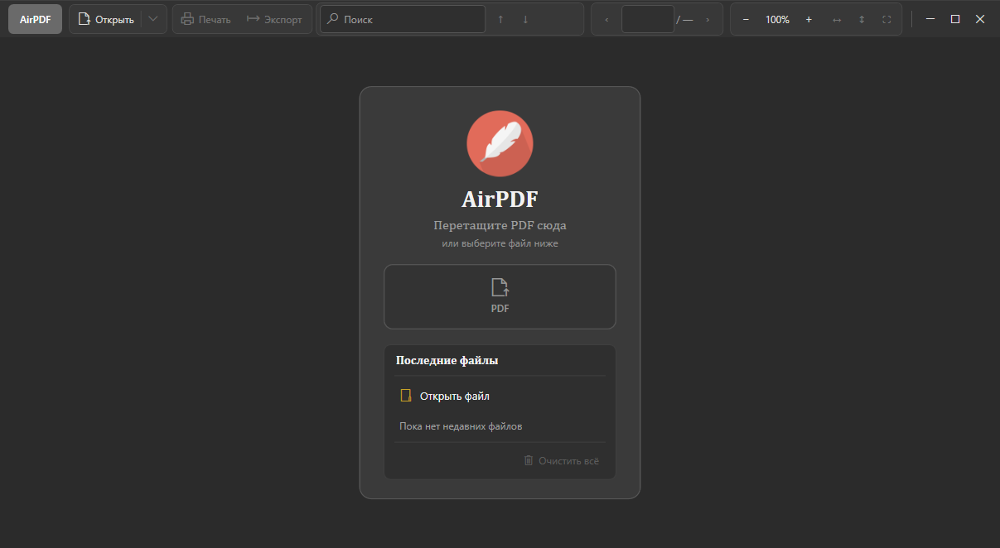

# AirPDF

Лёгкий просмотрщик PDF для Windows (WPF, win-x64).



## Возможности

- Просмотр PDF (DPI-aware рендер)
- Панель навигации: миниатюры и оглавление (закладки PDF)
- Поиск по текстовому слою + OCR для сканов (Tesseract eng/rus)
- Выделение и копирование текста, поворот страницы
- Переходы по ссылкам внутри PDF и внешним URL
- Печать, экспорт в Microsoft Word

## Требования

- Windows 10/11, **x64**
- Для сборки из исходников: [.NET 10 SDK](https://dotnet.microsoft.com/download)
- Вариант **dotnet** из релизов: [.NET Desktop Runtime](https://dotnet.microsoft.com/download/dotnet) win-x64  
  Вариант **full** — self-contained, runtime не нужен

## Сборка

```powershell
dotnet build -c Release -p:Platform=x64
```

## Горячие клавиши

| Клавиша | Действие |
|--------|----------|
| Ctrl+O | Открыть |
| Ctrl+W | Закрыть документ |
| Ctrl+F | Поиск |
| Ctrl+P | Печать |
| F4 | Панель навигации |
| F11 | Полный экран |
| Ctrl+C / Ctrl+A | Копировать / выделить всё (текст страницы) |

## Релизы

- `AirPDF-*-win-x64-dotnet.zip` — компактный, нужен Desktop Runtime
- `AirPDF-*-win-x64-full.zip` — со встроенным runtime

## Лицензия

Сторонние компоненты: Docnet/PDFium, Tesseract, Open XML SDK — согласно их лицензиям.
